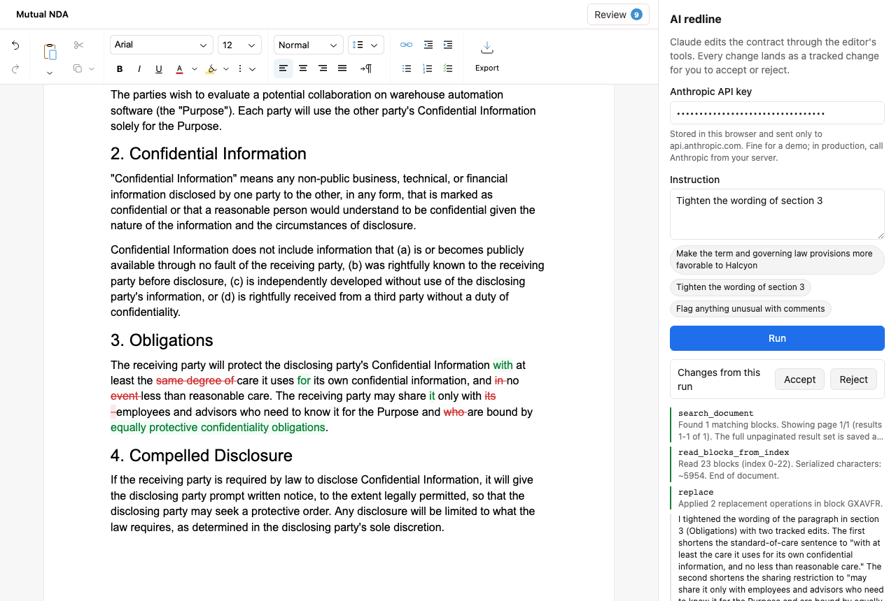

# AI redline: your model, tracked changes

Ask Claude to edit a contract. Claude works through the editor's own document
tools, and every edit lands as a tracked change you accept or reject inline,
the same way you'd review a colleague's redline in Word.



What it shows:

- `editor.tools.getDefinitions()`: the editor's JSON-schema tools, handed
  straight to Claude
- `editor.tools.executeDynamic()`: running the model's tool calls against the
  open document
- Tracked changes from an agent, attributed to "Claude" with `agent={{ name }}`
- `review.acceptSuggestions()` / `rejectSuggestions()` on exactly the changes
  one run created

There is no server. The browser calls the Anthropic API directly with a key you
paste into the sidebar.

## Run it

```bash
npm install
npm run dev
```

Open the printed URL, paste an [Anthropic API key](https://console.anthropic.com/settings/keys),
pick an instruction, and press **Run**.

## How the loop works

All of it is in [`src/agent.ts`](src/agent.ts). Give Claude the editor's tool
schemas:

```ts
const tools = editor.tools.getDefinitions().map((tool) => ({
  name: tool.name,
  description: tool.description,
  input_schema: tool.inputSchema,
}));
```

Run each tool call Claude makes against the editor, and send back the result.
Read and search tools return the document itself, with block IDs, in
`context.html`. Claude edits by those IDs, so send it along with the summary:

```ts
const result = await editor.tools.executeDynamic(block.name, block.input);
if (result.ok) {
  suggestionIds.push(...(result.value.suggestionIds ?? []));
  content = [result.value.message, result.value.context?.html].filter(Boolean).join("\n\n");
} else {
  // Rejected edits don't throw. Tell the model why, and it will retry.
  content = `${result.error.code}: ${result.error.message}`;
}
```

Repeat until Claude stops calling tools. Tool edits are tracked changes by
default, and `suggestionIds` lists the ones each call created, so the sidebar
can accept or reject exactly what this run did:

```ts
editor.review.acceptSuggestions(suggestionIds);
```

## In production

This example keeps your key in the browser's `localStorage` and sends it to
`api.anthropic.com` (that's what `dangerouslyAllowBrowser: true` allows). That's
fine for trying it out with your own key, but in a real product the key belongs
on your server.

[`server/proxy.ts`](server/proxy.ts) is a minimal proxy that adds the key on the
way through:

```bash
ANTHROPIC_API_KEY=sk-ant-... npx tsx server/proxy.ts
```

Then point the client at it. Nothing else changes, because the loop and the
tools still run in the browser, next to the document:

```ts
const client = new Anthropic({
  apiKey: "unused",
  baseURL: "http://localhost:8787",
  dangerouslyAllowBrowser: true,
});
```

A real proxy would also authenticate your users and rate-limit them.

## Learn more

- [Tools for your agent](https://revise.io/developer/docs/editor-sdk/guides/agent-tools)
- [Tracked changes](https://revise.io/developer/docs/editor-sdk/guides/tracked-changes)
- [Agent tool reference](https://revise.io/developer/docs/editor-sdk/api/agent-tools)
