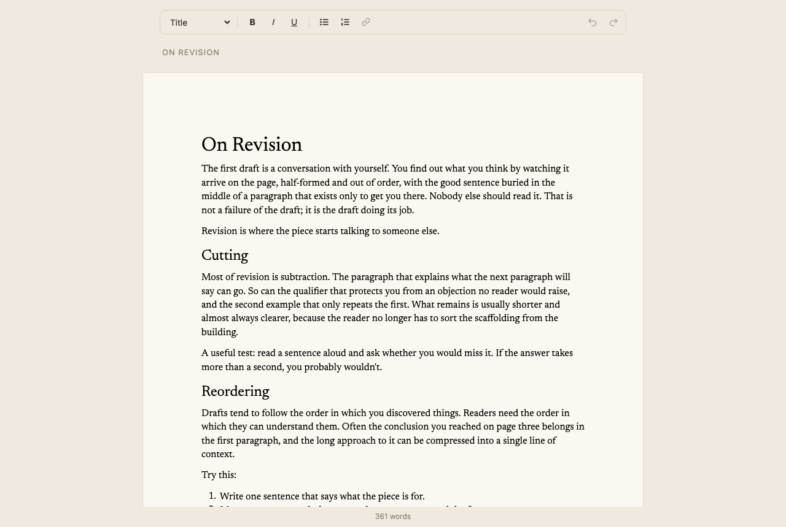

# Bring your own UI

A distraction-free writing app that doesn't look like Revise. The built-in
ribbon and title bar are turned off. A small toolbar of plain React buttons
drives the editor through its handle, the page colors and typeface come from
props, and a word count sits in the footer. Everything else (layout,
pagination, input, undo, and keyboard shortcuts like Cmd+B) still comes from
the editor.



## Run it

```bash
npm install
npm run dev
```

## Key code

Turn off the built-in chrome and keep the handle
([`src/App.tsx`](src/App.tsx)):

```tsx
<ReviseEditor
  initialDocuments={[{ id: "essay", source: essay }]}
  toolbarMode="none"
  showTitleBar={false}
  theme={scheme}
  canvasBackground="#efe9df"
  pageBackground="#fbf8f2"
  fonts={[{ family: "Newsreader", cssFamily: '"Newsreader", Georgia, serif' }]}
  onReady={(handle) => {
    editor.current = handle;
    handle.toolbar.subscribe(setToolbar); // pressed states, undo/redo, block type
  }}
  onChange={recount}
/>
```

Each button calls a toolbar command and reads its state back:

```tsx
<button
  aria-pressed={toolbar?.formatting.bold}
  onClick={() => editor.current?.toolbar.toggleBold()}
>
  B
</button>

editor.current.toolbar.setHeading(2);             // or setHeading() for body text
editor.current.toolbar.toggleList("ordered");
editor.current.view.setTitle(title);
editor.current.getStatistics().wordCount;          // no layout pass, cheap to call
```

Put `onMouseDown={(e) => e.preventDefault()}` on the toolbar so clicks don't
take focus, and the selection, away from the document.

The essay is a `.docx` (`src/essay.docx`) because its typeface is stored in
the document. Markdown and HTML sources open in the editor's default font.

## Docs

- [Chrome and toolbars](https://revise.io/developer/docs/editor-sdk/guides/chrome)
- [Appearance: theme, colors, fonts](https://revise.io/developer/docs/editor-sdk/guides/appearance)
- [`ReviseEditorHandle`](https://revise.io/developer/docs/editor-sdk/api/handle)
