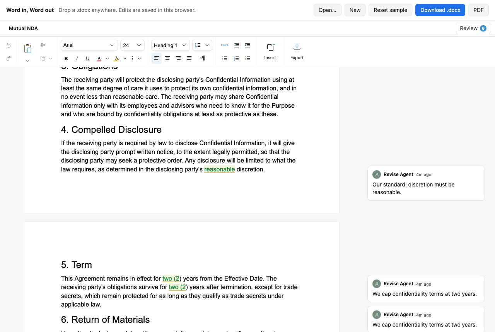

# Word in, Word out

Open a `.docx`, edit it, and download it as `.docx` or PDF. Comments and
tracked changes survive the round trip. Every change is saved to IndexedDB
as you type, so the document is still there after a reload.



## Run it

```bash
npm install
npm run dev
```

The sample is a mutual NDA that already carries tracked changes and comments,
made by the [`server-redline`](../server-redline) example. Drop any `.docx`,
`.md`, `.txt`, or `.html` file on the window to open it instead.

## Key code

Open a file and export it again ([`src/App.tsx`](src/App.tsx)):

```tsx
<ReviseEditor
  initialDocuments={[{ id, title, source: file }]}
  onReady={(handle) => (editor.current = handle)}
/>;

const docx = await editor.current.tools.export({ format: "docx" });
const pdf = await editor.current.tools.export({ format: "pdf" });
```

Every Revise document is a [Yjs](https://yjs.dev) document, so saving to the
browser is a Yjs provider. `connect` hands you the editor's `Y.Doc`, and
[y-indexeddb](https://github.com/yjs/y-indexeddb) stores every change:

```tsx
const connect = useCallback((ydoc) => {
  const persistence = new IndexeddbPersistence(doc.id, ydoc);
  persistence.whenSynced.then(() => setSynced(true));
  return persistence;
}, [doc.id]);

// Until `synced`, the editor waits. Then it joins the stored copy, or on the
// first visit seeds it from `source`.
collaboration: { connect, synced, awareness: null }
```

The same pattern works with any Yjs provider, so moving from browser storage
to your own sync server doesn't change the editor code. See the
[`multiplayer`](../multiplayer) example.

## Learn more

- [Input formats and export](https://revise.io/developer/docs/editor-sdk/guides/formats)
- [Documents](https://revise.io/developer/docs/editor-sdk/guides/documents)
- [Collaboration and Yjs](https://revise.io/developer/docs/editor-sdk/guides/collaboration)
