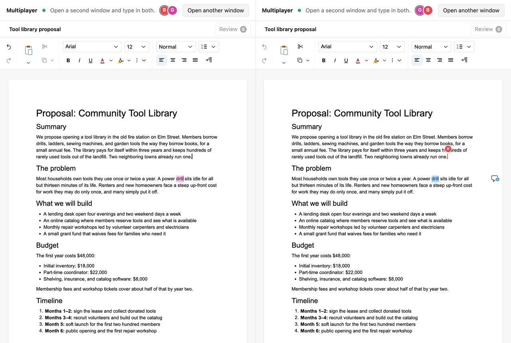

# Multiplayer

Real-time collaboration in the [Revise](https://revise.io/sdk) editor. Open the
app in two windows and type in both: you get live carets, selections,
presence, and a roster, over a [Hocuspocus](https://tiptap.dev/docs/hocuspocus)
server you run yourself.



## Run it

```bash
npm install
npm run dev
```

This starts the collaboration server on port 1234 and the app on
[localhost:5173](http://localhost:5173). Click **Open another window**, or
open the URL in a second browser.

## How it works

Every Revise document is a [Yjs](https://yjs.dev) document, so collaboration
is a matter of attaching a transport. The editor builds the `Y.Doc` and
awareness, and `connect` hands them to a Hocuspocus provider
([`src/App.tsx`](src/App.tsx)):

```tsx
const connect = useCallback(
  (document, awareness) =>
    new HocuspocusProvider({
      url: "ws://localhost:1234",
      name: "community-tool-library",
      document,
      awareness,
      onSynced: () => setSynced(true),
    }),
  [],
);

<ReviseEditor
  currentUser={{ id, name, color }} // labels your caret for everyone else
  initialDocuments={[
    {
      id: "community-tool-library",
      collaboration: { connect, synced, seed: "never" },
    },
  ]}
/>;
```

The editor keeps the document closed until `synced` is true, so nobody sees an
empty, editable page before the room arrives. The roster comes from
`editor.collaboration.subscribe()`, with the same colors the carets use.

The server creates each room ([`server.ts`](server.ts)) with
`@reviseio/editor/server`:

```ts
Server.configure({
  port: 1234,
  async onLoadDocument({ document }) {
    await seedYDocFromFile(document, proposal, "proposal.md");
  },
}).listen();
```

Seeding on the server means two people opening a new room at the same moment
can never both import the document, which is why clients pass
`seed: "never"`. The alternative is to give every client a `source` and let
the first one in seed the room (`seed: "if-empty"`, the default).

## Before production

- **Authenticate on the transport.** The SDK never opens a connection or
  checks who is connecting. Use Hocuspocus's `onAuthenticate` hook (or your
  own transport's equivalent) to decide who may join a room.
- **Persist rooms.** This server keeps rooms in memory, so they reset when it
  restarts. Add a Hocuspocus extension such as `@hocuspocus/extension-database`
  to store them, and seed only rooms that don't exist yet.
- **Enforce roles on the server.** The `role` prop limits what one browser can
  do, but each client sets its own. If some participants may only suggest or
  view, reject their writes at the transport.

## Learn more

- [Collaboration guide](https://revise.io/developer/docs/editor-sdk/guides/collaboration)
- [Backend reference (`@reviseio/editor/server`)](https://revise.io/developer/docs/editor-sdk/api/backend)
- [Roles and permissions](https://revise.io/developer/docs/editor-sdk/guides/roles)
