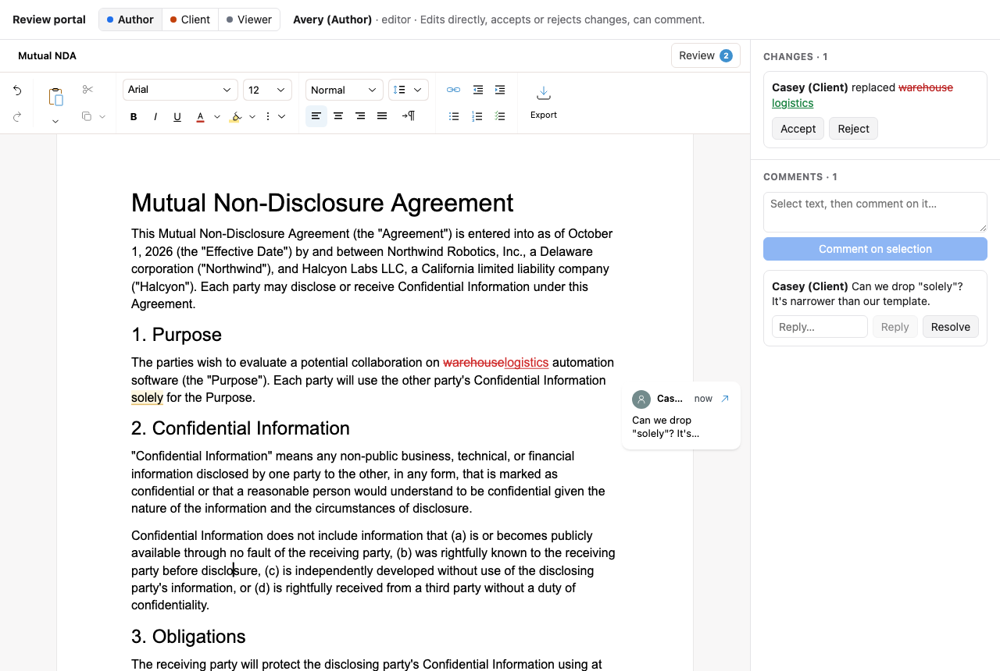

# Review portal: roles and comments

One contract, three people with different permissions. Switch persona in the
header:

| Persona | Role | Can do |
| --- | --- | --- |
| Author | `editor` | Edit directly, accept or reject changes, comment |
| Client | `suggester` | Edit only as tracked suggestions, comment. Cannot accept or reject |
| Viewer | `viewer` | Read the document and comments. Nothing else |

The sidebar is a custom review panel built from the editor's `review`
controller. It lists pending changes with their author, threads with replies,
and a box for commenting on the selected text. Accept and Reject appear only
for a role that may resolve changes, read from `rolePolicy(role)`. Tracked
changes render as classic Word redlines.



## Try it

1. As **Client**, select a word and type over it. It becomes a suggestion
   signed "Casey (Client)".
2. Select some text, write a comment in the sidebar, and click **Comment on
   selection**.
3. Switch to **Author**. The change and the comment are attributed to Casey.
   Accept the change and reply to the comment.
4. Switch to **Viewer** and try typing. Nothing happens.

## Run

```bash
npm install
npm run dev
```

## Key code

The role and the identity are plain props, and both can change while the
document is open ([`src/App.tsx`](src/App.tsx)):

```tsx
<ReviseEditor
  initialDocuments={[{ id: "nda", title: "Mutual NDA", source }]}
  role={persona.role}          // "editor" | "suggester" | "viewer"
  currentUser={persona.user}   // signs suggestions and comments
  settings={{
    trackedChanges: { markupStyle: "word", showRemovalsInReview: true },
  }}
/>
```

The review panel ([`src/ReviewSidebar.tsx`](src/ReviewSidebar.tsx)) subscribes
to review state and re-reads the change list when it moves:

```ts
editor.review.subscribe((state) => {
  setReview(state); // comment threads, counts
  setChanges(editor.review.listChanges()); // author, kind, inserted/deleted text
});

if (rolePolicy(role).canResolveSuggestions) {
  editor.review.acceptSuggestions([change.id]);
}
```

Commenting from your own UI moves focus out of the editor, which clears its
selection. Capture the selection before focus moves and restore it before
adding the comment:

```ts
const capture = editor.selection.capture(); // on mousedown in the textarea
// …the user types…
editor.selection.restore(capture);
editor.review.addCommentAtSelection(text);
```

## Roles are not security

A role limits what this browser can do through the SDK. It does not
authenticate anyone. This demo switches personas in one editor for
convenience. In a real app, each person has their own editor, connected to a
shared document. Your server assigns their role, and your transport rejects
writes the role does not allow.

## Learn more

- [Roles and permissions](https://revise.io/developer/docs/editor-sdk/guides/roles)
- [Comments](https://revise.io/developer/docs/editor-sdk/guides/comments)
- [Tracked changes](https://revise.io/developer/docs/editor-sdk/guides/tracked-changes)
